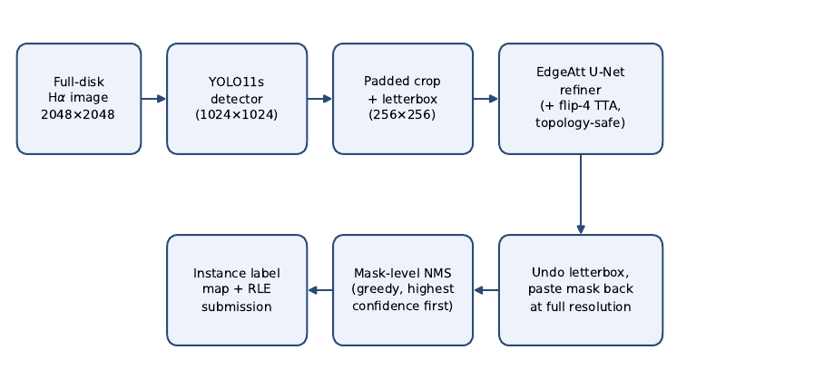

# MaskStitch — Solar Filament Segmentation 2026

Our solution to the [Solar Filament Segmentation Challenge 2026](https://www.kaggle.com/competitions/filament-segmentation-2026)
(Kaggle / IEEE BigData Cup), on the MAGFiLO GONG H-alpha dataset. A YOLO11
detector proposes each filament's bounding box, a compact edge-attention
U-Net refines a mask per crop, and the crops are stitched back into a
full-resolution instance map with a greedy mask-level NMS.

**Best result: PQ = 0.4571** on the held-out validation split (official
organizer self-eval logic), scoring **0.37** on the withheld test partition — see the [technical report](kaggle_comp_report_fi_segm_Marchezi_2026/main.tex)
for the full methodology, ablations, and discussion, or run through
[`notebooks/pipeline_walkthrough.ipynb`](notebooks/pipeline_walkthrough.ipynb)
for an executable, illustrated walkthrough of the whole pipeline.

[`notebooks/pipeline_walkthrough.ipynb`](notebooks/pipeline_walkthrough.ipynb) runs the
whole thing end to end — data, rasterization convention, detect, crop, refine, stitch,
evaluate — and regenerates the submitted CSV. Its output is **byte-identical** to the
submitted file (same SHA-256 over the sorted rows), so nothing outside the repository is
needed to reproduce the predictions.

Originally prototyped as a Kaggle notebook (kept for reference in
[`notebooks/`](notebooks/)); the pipeline lives as an installable Python
package under [`src/solar_filaments/`](src/solar_filaments/).



## Approach

1. **Detect** — a YOLO11 detector proposes each filament. Two variants are interchangeable within the noise: a 9M-parameter box detector at 1024x1024, and the adopted 27.6M-parameter instance-segmentation network at the native 2048x2048.
2. **Crop** — each detection is padded and letterbox-resized (256x256) out of the native-resolution image, preserving the filament's true aspect ratio.
3. **Refine** — a compact U-Net (8.8M params) with an edge-guided attention bottleneck predicts a binary mask per crop; at inference, the prediction is optionally averaged over 4 flips and accepted only if that average doesn't change the single-view mask's topology (`--tta`).
4. **Stitch** — per-crop masks are pasted back into a full-resolution instance label map via greedy, confidence-ordered mask-level NMS (box IoU is a poor proxy for "same object" on long, thin, diagonal filaments), then scored with the competition's own Panoptic Quality (PQ) + Dice self-eval logic, ported verbatim from the [organizers' self-evaluation notebook](https://www.kaggle.com/code/azimahmadzadeh/self-evaluation-notebook) (see [`src/solar_filaments/eval/self_eval.py`](src/solar_filaments/eval/self_eval.py)).

### What we varied, and what actually moved the metric

Every extension below is an opt-in CLI flag, independently toggleable. The
short version: across ten axes, the only change that cleared the measured
noise floor was retuning two *inference* thresholds **together** rather than
one at a time. Architecture, capacity, training target and extra unlabelled
data all came back null.

| Axis | Flag | Result |
|---|---|---|
| Detector architecture (9M @1024 vs 27.6M @2048) | `--detector {yolo,yolo-seg,maskrcnn}` | equivalent within noise |
| Annotator-merge target (single / majority / union) | `prepare --annotator-merge` | equivalent within noise |
| Refiner capacity (8.8M vs ResNet18, 15.4M) | `train-unet --encoder resnet18` | +0.009 crop Dice, +0.000 PQ |
| Crop context (pad factor) | `train-unet --pad-factor` | null once retrained; a 0.08 PQ trap if mismatched |
| Learned candidate re-scorer (10 features) | `--rescorer-thres` | AUC 0.845 vs 0.777, but same PQ |
| Extra proposal source (full-disk semantic) | `--semantic-thres` | recall up, PQ down |
| Semi-supervision on 2500 archive images | `experiments/semisupervised/` | null at best, recall collapse at low label density |
| Oriented bounding boxes | `--obb` | better instance quality, lower recall |
| Photometric normalization | `--normalize` | below baseline |
| **Joint retuning of `--conf-thres` and `--mask-thresh`** | — | **+0.014 PQ, and the one gain confirmed on the withheld set** |

Two evaluation details were worth more than any model change: the polygon
rasterization convention (`cv2.fillPoly` vs pycocotools — see the report), and
the fact that inference constants like `--mask-thresh` and `--pad-factor` are
properties of the trained weights, not of the task, and do not transfer
between model generations.

## Setup

```bash
python3 -m venv .venv --system-site-packages   # inherits an existing CUDA-matched torch, if present
source .venv/bin/activate
pip install -e .
```

`requirements.txt` pins the exact versions this solution was developed and
evaluated against, if you'd rather not resolve dependencies from
`pyproject.toml` yourself:

```bash
pip install -r requirements.txt
pip install -e . --no-deps
```

To run [`notebooks/pipeline_walkthrough.ipynb`](notebooks/pipeline_walkthrough.ipynb)
interactively, also install the notebook extras: `pip install -e .[notebook]`.

Paths are environment-variable overridable (see [`src/solar_filaments/config.py`](src/solar_filaments/config.py)):

- `FILAMENT_DATA_ROOT` — defaults to `/data/marchezi/filament_segmentation_2026/MAGFiLO_1.0_Kaggle_2026`
- `FILAMENT_WORK_DIR` — defaults to `./work` (checkpoints, YOLO runs, splits, submission.csv). Not checked into git (see `.gitignore`) — regenerate it with the commands below.

### Getting the data

```bash
mkdir -p ~/.kaggle && chmod 700 ~/.kaggle
cp ~/Downloads/kaggle.json ~/.kaggle/kaggle.json && chmod 600 ~/.kaggle/kaggle.json
bash experiments/pipelines/download_data.sh
```

## Usage

### 1. Prepare the datasets

```bash
filament prepare                                          # single 90/10 split, axis-aligned only
filament prepare --k-folds 5 --augment-copy-paste 300      # 5-fold + synthetic copy-paste augmentation
filament prepare --obb                                     # also build the OBB-label dataset
filament prepare --normalize                                # also build the limb-darkening+CLAHE dataset
filament prepare --seg                                      # also build the YOLO-seg polygon dataset
filament prepare --annotator-merge majority                 # consensus rule for multi-annotator images (default)
```

MAGFiLO images can carry 1-3 independent annotator records, and they disagree
a lot (only ~44% of one annotator's filaments are matched by every other
annotator of the same image). `--annotator-merge` turns those records into one
detector target set per physical image: `majority` (filaments >= 50% of the
annotators marked), `union` (every clustered filament), or `single` (one
record). The marginal analysis puts the PQ break-even annotator support at
0.32, below every support level MAGFiLO actually contains, which argues for
`union`; measured on held-out data the three are indistinguishable.

### 2. Train the detector

```bash
filament train-yolo --epochs 60 --imgsz 1024               # axis-aligned boxes (original pipeline)
filament train-yolo --seg --epochs 60                       # YOLO11 instance segmentation (needs `prepare --seg`)
filament train-maskrcnn --epochs 20                         # torchvision Mask R-CNN (COCO-pretrained, ~170 MB download on first use)
filament train-yolo --obb --epochs 60                       # oriented boxes (needs `prepare --obb` first)
filament train-yolo --normalize --epochs 60                 # normalized images (needs `prepare --normalize` first)
filament train-yolo --fold 0 --epochs 60                    # a single k-fold fold (also for train-maskrcnn)
# resume an interrupted run:
filament train-yolo --resume --weights work/runs/yolo11s_filament_detect/weights/last.pt
```

All three detectors feed the same crop-level U-Net refiner, mask-level NMS and
flip-TTA (`src/solar_filaments/detectors/` + `inference.refine_candidates`);
pick one at evaluate/predict time with `--detector {yolo,yolo-seg,maskrcnn}`.

### 3. Train the U-Net refiner

```bash
filament train-unet --epochs 40                             # axis-aligned, BatchNorm
filament train-unet --instance-norm --epochs 40              # InstanceNorm instead of BatchNorm
filament train-unet --normalize --epochs 40                  # trained on preprocessed crops
filament train-unet --obb --epochs 40                        # paired with an OBB-trained detector
```

### 4. Self-evaluate on the held-out split

```bash
filament evaluate --quick 8 --full                           # axis-aligned baseline
filament evaluate --detector yolo-seg --tta --imgsz 2048 \
    --conf-thres 0.25 --mask-thresh 0.5 --full                  # adopted config (PQ=0.4571)
filament evaluate --obb --full                                # OBB
filament evaluate --classical --full                          # non-learned baseline, no GPU
filament evaluate --ensemble --full                            # axis-aligned + OBB (+ classical) merge
filament evaluate --fold all --full                            # pool out-of-fold PQ across every k-fold split
filament evaluate --detector maskrcnn --score-thres 0.6 --full # Mask R-CNN backend + U-Net refiner
filament evaluate --detector yolo-seg --full                    # YOLO-seg backend + U-Net refiner
filament evaluate --detector maskrcnn --no-refine --full        # ablation: the detector's own masks, no refiner
```

Every line prints PQ with its decomposition (`SQ x RQ`, TP/FP/FN, GT miss
rate, prediction FP rate, fragmentation and over-merge rates) so recall and
precision problems are visible separately. Every model variant needs its own
`--conf-thres` (or `--score-thres`) sweep before its PQ is trustworthy — a
threshold tuned for one configuration does not transfer to another — and the
number to trust is the **out-of-fold PQ over all 707 images**
(`--fold all`), not the single 70-image split: the first public-leaderboard
submission scored 0.36 PQ against a single-split local 0.44.

### 5. Generate the test-set submission

```bash
filament predict --detector yolo-seg --tta --imgsz 2048 \
  --conf-thres 0.25 --mask-thresh 0.5 --mask-nms-thresh 0.15
```

The two thresholds must be set together: `--mask-thresh 0.5` alone, or
`--conf-thres 0.25` alone, each lands on a worse operating point than the pair.

Writes `filament_id,segmentation_rle` rows (pycocotools compressed RLE,
fixed 2048x2048 per image) to `work/submission.csv`.

## Tests

```bash
pip install -e .[dev]
pytest
```

40 tests, no GPU and no competition data required for most of them (the ones that read
MAGFiLO skip cleanly if it is absent). They are not decorative: each pins a bug this
project actually had.

| what it guards | why |
|---|---|
| `test_rasterization.py` | `polygon_to_mask` must match `pycocotools`, not `cv2.fillPoly`. One test asserts the two conventions still *disagree*, so if they ever converge the caveat in the report is flagged as stale. |
| `test_metric.py` | PQ on cases computable by hand, including that it is pooled globally rather than averaged per image (0.667 vs 0.5 on a two-image case). |
| `test_splits_and_targets.py` | splits must be disjoint at the level of the photograph, not the annotation record; annotator-merge counts must be monotone. |
| `test_submission_format.py` | RLE round-trips through pycocotools *and* through a CSV write/read. |
| `test_refiner_loading.py` | a checkpoint's encoder is inferred from its weights, and requesting the wrong one raises instead of loading a mismatched architecture. |
| `test_solar_angles.py` | *P* and *B*₀ against the standard ephemeris, including that removing *P* moves a near-equator point across the hemisphere boundary. |
| `test_cli.py` | every subcommand builds its parser and formats its help — an unescaped `%` in one help string used to break `train-fulldisk` silently. |

## Repository structure

```
src/solar_filaments/       installable package (CLI, data, models, inference, eval)
experiments/               analyses, figure scripts, the semi-supervised study, run chains
notebooks/                 pipeline_walkthrough.ipynb (start here) + the original Kaggle prototype
tests/                     40 tests; see above
kaggle_comp_report_fi_segm_Marchezi_2026/   4-page technical report (ACM template, main.tex)
docs/figures/              standalone copies of report figures, for this README
requirements.txt           pinned dependency versions
```

## License

See [`LICENSE`](LICENSE). This repository uses the MAGFiLO dataset and
competition materials under the terms of the
[Solar Filament Segmentation Challenge 2026](https://www.kaggle.com/competitions/filament-segmentation-2026/rules).
